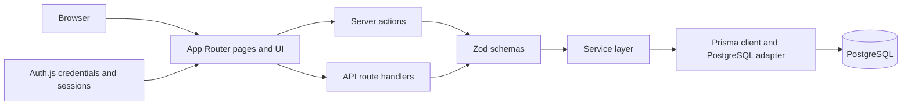

# Kayuping

**A wood inventory and operations system for managing timber from purchase to sale.**

Kayuping gives teams one place to track wood stock, where it is stored, and how it changes as it moves through day-to-day operations.

## What it does

- Track inventory by wood variant, location, grade, and lot.
- Manage master data for woods, materials, grades, locations, and contacts.
- Record purchases, movements, processing, grading, adjustments, and sales.
- Review stock mutations as an audit trail of inventory changes.
- Protect administrative screens with sign-in and permission-aware access.

## Demo

Screenshots from the `demo/` folder:

| Inventory by wood variant | Inventory by location | Stock mutation history |
| --- | --- | --- |
|  |  |  |

## Tech stack

| Area | Technologies |
| --- | --- |
| Application | Next.js 16 App Router, React 19, TypeScript |
| UI | Tailwind CSS 4, shadcn/ui, Radix UI |
| Data and validation | PostgreSQL, Prisma 7, Zod |
| Authentication | Auth.js / NextAuth credentials |
| Forms and tables | React Hook Form, TanStack Table |

## Architecture

The app is organized around Next.js App Router pages and API endpoints, with shared business logic and data access on the server.



- `app/` contains the App Router pages and API route handlers. Administrative pages require an authenticated user.
- `components/` contains feature-specific admin UI, shared components, and reusable UI primitives.
- `lib/actions/`, `lib/schemas/`, and `lib/services/` separate mutations, input validation, and domain/data operations.
- `lib/db/` configures Prisma and database seeding. The data model is split across `prisma/models/`; migrations are in `prisma/migrations/`.

## Run locally

### Prerequisites

- Node.js 20.9 or newer
- PostgreSQL
- npm

### Setup

1. Install dependencies:

   ```bash
   npm ci
   ```

2. Create a PostgreSQL database, then copy `.env.example` to `.env` and set `DATABASE_URL` to your PostgreSQL connection string and `AUTH_SECRET` to a long random secret. Include your database credentials in the connection string if your local PostgreSQL setup requires them.

   On PowerShell, copy the example with `Copy-Item .env.example .env`.

3. Generate the Prisma client, apply local migrations, and load the development seed data:

   ```bash
   npx prisma generate
   npx prisma migrate dev
   npx prisma db seed
   ```

4. Start the development server:

   ```bash
   npm run dev
   ```

   Open [http://localhost:3000](http://localhost:3000). The seed creates a local admin account (`admin@mail.com` / `admin123`); use it only for local development and replace or remove it before deploying.

## Quality checks

```bash
npm run lint
npm run typecheck
npm run build
```
